# Laporan Praktikum Minggu 6: Authentication, Security & Firebase Cloud Messaging (FCM)

**Mata Kuliah:** Pemrograman Mobile  
**Program Studi:** D4 Teknik Informatika / Sistem Informasi Bisnis  
**Jurusan:** Teknologi Informasi — Politeknik Negeri Malang  
**Mahasiswa:** Arifah Zhafirah  
**NIM:** 244107020188  
**Aplikasi:** Campus Notify (`campus_notify`)

---

## Daftar Isi
1. [Ringkasan Proyek](#1-ringkasan-proyek)
2. [AI Verification Checklist](#2-ai-verification-checklist)
3. [Checklist Verifikasi Mandiri](#3-checklist-verifikasi-mandiri)
4. [Matriks Pengujian Tiga App State (Foreground, Background, Terminated)](#4-matriks-pengujian-tiga-app-state)
5. [Refleksi Teknis](#5-refleksi-teknis)
6. [Dokumentasi dan Bukti Pengujian (Screenshots)](#6-dokumentasi-dan-bukti-pengujian-screenshots)
7. [Hasil Analisis dan Pengujian Otomatis (CI/Test)](#7-hasil-analisis-dan-pengujian-otomatis-citest)

---

## 1. Ringkasan Proyek

Aplikasi **Campus Notify** dirancang untuk menangani pengumuman akademik kampus secara *real-time* dengan arsitektur keamanan modern:
- **Autentikasi & Keamanan:** Penyimpanan token autentikasi (`access_token` dan `refresh_token`) menggunakan penyimpanan terenkripsi perangkat keras (`flutter_secure_storage`). Mendukung auto-refresh access token via Dio Interceptor saat menerima respons `401 Unauthorized`, dan auto-logout saat refresh token kedaluwarsa.
- **Firebase Cloud Messaging (FCM):** Penanganan pesan multi-state (Foreground via `flutter_local_notifications`, Background via top-level handler, dan Terminated via `getInitialMessage`).
- **Navigasi & Deep Linking:** Integrasi `go_router` decoupled dari `BuildContext` untuk mengarahkan pengguna langsung ke halaman detail pengumuman (`/pengumuman/:id`).
- **State Management:** Menggunakan `flutter_riverpod` untuk mengelola state autentikasi secara reaktif.

---

## 2. AI Verification Checklist

Berikut adalah verifikasi dan audit kritis terhadap draf kode AI sebelum disetujui dan diimplementasikan ke dalam aplikasi:

| No | Poin Verifikasi Modul | Status | Evaluasi & Bukti Teknis Kode |
|:--:|---|:---:|---|
| 1 | **Apakah background handler berupa fungsi top-level dengan `@pragma('vm:entry-point')`?** *(Tolak jika berupa method kelas)* | ✅ **VALID** | **Diterima.** Dideklarasikan di `lib/messaging/push_service.dart` sebagai fungsi murni top-level `Future<void> firebaseMessagingBackgroundHandler(RemoteMessage message)` di luar kelas, serta dianotasi `@pragma('vm:entry-point')`. Ini krusial agar fungsi tidak di-*tree-shake* oleh kompilator AOT Dart dan dapat dipanggil oleh engine native Android/iOS saat isolate UI tidak aktif. |
| 2 | **Apakah `onTokenRefresh` benar-benar mengirim token baru ke backend, bukan hanya dicetak ke log?** | ✅ **VALID** | **Diterima.** Listener `_messaging.onTokenRefresh.listen((newToken) async { await _sendTokenToBackend(newToken); });` aktif memanggil endpoint `POST /devices` via Dio dengan payload `fcm_token`, `platform`, dan `updated_at`. Token tidak hanya di-print, melainkan disinkronkan ke database server kampus. |
| 3 | **Apakah foreground memakai local notification manual?** *(Tanpa ini banner tidak muncul saat aplikasi terbuka)* | ✅ **VALID** | **Diterima.** Sistem Android secara native menekan visual banner notifikasi saat aplikasi berada di *foreground*. Solusinya, listener `FirebaseMessaging.onMessage` memicu `_localNotifications.show()` dengan `AndroidNotificationChannel` prioritas tinggi (`Importance.high`, `Priority.high`) dan `DarwinNotificationDetails` untuk iOS. |
| 4 | **Apakah klik dari ketiga state (foreground/background/terminated) masuk ke rute yang benar?** | ✅ **VALID** | **Diterima & Terbukti.** Fungsi `routeFromMessage(data)` memetakan payload `'route': '/pengumuman/3'` secara konsisten. Navigasi decoupled dari BuildContext melalui `_navigateTo(route)`: <br>• **Foreground:** via callback `onDidReceiveNotificationResponse`<br>• **Background:** via stream `onMessageOpenedApp`<br>• **Terminated:** via `getInitialMessage()` dengan buffer antrean `_pendingInitialRoute`. |
| 5 | **Apakah token/secret tidak di-hardcode dan tidak di-log penuh?** | ✅ **VALID** | **Diterima & Diperbaiki.** Token disamarkan secara ketat lewat `_maskToken(token)` (`${token.substring(0, 12)}...`). Tidak ada token API, secret key, atau password yang di-hardcode dalam repositori. Kredensial pengguna disimpan dalam `FlutterSecureStorage`. |
| 6 | **Keputusan final dan alasan teknis Anda, boleh berbeda dari saran AI selama berargumen.** | ✅ **VALID** | **Diterapkan.** Terdapat 4 perbaikan kritis mandiri atas draf saran AI: <br>1. *Non-blocking Init* di `main()` agar UI tidak black screen saat cold start.<br>2. *Queue Rute Tertunda* (`_pendingInitialRoute`) untuk mencegah race condition deep link saat terminated.<br>3. *Masking Token Otomatis* pada seluruh output debug/UI.<br>4. *Decoupled Router* menghindari runtime error widget lookup tanpa `BuildContext`. |

---

## 3. Checklist Verifikasi Mandiri

- [x] **Token hanya di `flutter_secure_storage`, tidak di SharedPreferences/log/screenshot penuh.**  
  *(Diverifikasi pada `TokenStore` di `lib/data/token_store.dart`. Token dienkripsi menggunakan KeyStore/Keychain, dan tampilan UI maupun log menggunakan fungsi masking).*
- [x] **401 memicu refresh sekali lalu retry; refresh mati memaksa login ulang.**  
  *(Diverifikasi pada `buildApiClient` di `lib/data/api_client.dart` dan pengujian unit `test/auth_push_test.dart`. Saat interceptor mendeteksi HTTP 401, refresh token dipanggil, access token diperbarui, dan request diulang. Jika proses refresh gagal, seluruh sesi dibersihkan via `store.clear()` sehingga user diarahkan kembali ke layar Login).*
- [x] **Ketiga app state teruji dengan tabel bukti; klik masuk ke rute yang benar.**  
  *(Diverifikasi pada skenario Foreground, Background, dan Terminated; seluruhnya berhasil bernavigasi ke rute pengumuman spesifik).*
- [x] **Topik untuk broadcast, token untuk pesan personal.**  
  *(Topik `pengumuman-kampus` digunakan untuk broadcast massal ke seluruh mahasiswa, sedangkan token perangkat individual dikirim ke backend `/devices` untuk pesan personal akademik seperti nilai, KRS, dan tagihan UKT).*
- [x] **`flutter analyze` bersih dan semua test lulus.**  
  *(Hasil `flutter analyze`: **No issues found!**; Hasil `flutter test`: **All tests passed! (5/5 tests lulus)**).*

---

## 4. Matriks Pengujian Tiga App State

### Format Payload Pengujian (Firebase Cloud Messaging)
```json
{
  "message": {
    "topic": "pengumuman-kampus",
    "notification": {
      "title": "Jadwal kuliah berubah",
      "body": "Kelas Mobile pindah ke Ruang A2 jam 13.00"
    },
    "data": {
      "route": "/pengumuman/3",
      "id": "3"
    }
  }
}
```

### Tabel Hasil Pengujian Tiga State
| State Aplikasi | Skenario Pengujian | Perilaku yang Diharapkan | Hasil Pengujian | Referensi Bukti Screenshot |
|---|---|---|:---:|---|
| **Foreground** | Aplikasi sedang dibuka dan aktif di halaman Beranda (`/`). | Banner lokal heads-up muncul di bagian atas layar. Ketika banner diketuk, aplikasi langsung membuka detail pengumuman `/pengumuman/3`. | ✅ **LULUS** | `screenshot/BerandaNotifikasiDikirim.jpeg`, `screenshot/DetailPengumuman.jpeg` |
| **Background** | Aplikasi diminimalkan ke latar belakang (menekan tombol Home ponsel). | Notifikasi sistem muncul di notification tray / status bar. Ketika diketuk, aplikasi kembali ke depan dan bernavigasi ke `/pengumuman/3`. | ✅ **LULUS** | `screenshot/NotifikasiDitirai.jpeg`, `screenshot/DetailPengumuman.jpeg` |
| **Terminated** | Aplikasi ditutup paksa / di-*swipe kill* dari recent apps. | Notifikasi sistem muncul di status bar. Ketika diketuk, aplikasi melakukan cold start dan secara otomatis langsung masuk ke `/pengumuman/3` tanpa macet. | ✅ **LULUS** | `screenshot/NotifikasiDitirai.jpeg`, `screenshot/DetailPengumuman.jpeg` |

---

## 5. Refleksi Teknis

### 1. Mengapa refresh token tidak boleh disimpan di SharedPreferences? Apa risikonya bila bocor?
- **Penyimpanan SharedPreferences di Android:** Data disimpan dalam bentuk berkas XML teks biasa (*plain text*) di direktori internal `/data/data/<package_name>/shared_prefs/`. Pada ponsel yang di-*root*, melalui fitur *ADB backup* (`adb backup`), atau aplikasi perusak (*malware*) yang memanfaatkan kerentanan sistem, berkas XML ini dapat diekstrak dan dibaca tanpa hambatan enkripsi.
- **Karakteristik Refresh Token:** Berbeda dengan `access_token` yang berumur pendek (*short-lived*, misal 15–60 menit), `refresh_token` bersifat jangka panjang (*long-lived*, berumur berminggu-minggu hingga berbulan-bulan).
- **Risiko Bila Bocor:** Apabila `refresh_token` bocor, penyerang dapat melakukan pembajakan sesi (*session hijacking*). Penyerang dapat terus menerus meminta `access_token` baru ke server tanpa perlu mengetahui kredensial kata sandi asli pengguna. Akibatnya, data pribadi dan nilai akademik mahasiswa dapat diakses, dimanipulasi, atau disalahgunakan secara permanen sampai pihak admin/backend mencabut (*revoke*) token tersebut secara manual.
- **Solusi yang Benar:** Wajib disimpan di `flutter_secure_storage`, yang memanfaatkan **Android Keystore System** (enkripsi berbasis hardware AES-GCM) pada Android dan **Keychain Services** pada iOS.

### 2. Apa yang rusak bila `onTokenRefresh` diabaikan selama satu semester perkuliahan?
- **Penyebab Terjadinya Refresh Token FCM:** Token registrasi perangkat FCM tidak bersifat statis permanen. Firebase SDK dan Google Play Services akan merotasi token ketika:
  1. Pengguna membersihkan data/cache aplikasi (*clear data*).
  2. Aplikasi dipulihkan di perangkat baru atau setelah update OS besar.
  3. Firebase SDK melakukan pembaruan berkala untuk alasan keamanan.
  4. Aplikasi tidak aktif dalam durasi yang cukup lama lalu dibuka kembali.
- **Dampak Fatal Selama Satu Semester:**
  - Database backend kampus akan tetap menyimpan token lama yang sudah usang (*stale token*).
  - Ketika kampus mengirim pengumuman krusial (seperti jadwal revisi ujian akhir semester, pembatalan kelas darurat, atau peringatan batas akhir pembayaran UKT), Firebase FCM server akan menolak pengiriman dengan status `UNREGISTERED` atau `INVALID_REGISTRATION`.
  - Terjadi fenomena **"Silent Drop"**: Server merasa notifikasi sudah dikirimkan, namun mahasiswa tidak pernah menerima notifikasi sama sekali di ponselnya.
  - Akumulasi token usang ini juga merusak reputasi deliverability server dan membebani kuota API FCM. Oleh karena itu, listener `onTokenRefresh` wajib secara otomatis menembak endpoint `POST /devices` untuk menjaga sinkronisasi token terbaru.

### 3. Kapan memakai topik dan kapan memakai token perangkat? Beri contoh pesan kampus untuk masing-masing.
- **FCM Topics (`topic`):**
  - *Karakteristik:* Model komunikasi **1-ke-Banyak (Broadcast / Multicast)**. Backend tidak perlu menyimpan jutaan token perangkat mahasiswa satu per satu; cukup mempublikasikan pesan ke satu *topic name*, dan FCM server yang menangani distribusinya secara massal.
  - *Kapan Digunakan:* Informasi publik yang relevan bagi seluruh sivitas akademika, jurusan, angkatan, atau kelas tertentu.
  - *Contoh Pesan Kampus via Topik:*
    1. *Topik `pengumuman-kampus`:* "Pengumuman Libur Nasional & Cuti Bersama: Seluruh aktivitas perkuliahan dan administrasi diliburkan pada 20-22 Oktober."
    2. *Topik `prodi-ti`:* "Kuliah Tamu Praktisi Industri: 'Arsitektur Cloud Native' akan dilaksanakan Sabtu ini di Aula Gedung TI."
    3. *Topik `jadwal-uas`:* "Jadwal Ujian Akhir Semester Ganjil TA 2026/2027 telah resmi dipublikasikan di portal akademik."
- **Device Registration Token (`token`):**
  - *Karakteristik:* Model komunikasi **1-ke-1 (Unicast / Personal / Transaksional)**. Pesan dikirimkan secara langsung dan eksklusif hanya ke perangkat dengan token unik milik pengguna tertentu.
  - *Kapan Digunakan:* Notifikasi privat yang memuat informasi sensitif, status transaksi, atau tindak lanjut akun individual.
  - *Contoh Pesan Kampus via Token Perangkat:*
    1. *Notifikasi KRS:* "Rencana Studi Anda (KRS) Semester 5 telah disetujui oleh Dosen Pembina Akademik."
    2. *Notifikasi Keuangan:* "Pembayaran UKT atas nama Arifah Zhafirah berhasil diverifikasi. Status perkuliahan Anda: AKTIF."
    3. *Notifikasi Nilai/Tugas:* "Nilai Tugas Praktikum Minggu 6 telah diperbarui oleh Dosen Pengampu: 100 (A)."
    4. *Keamanan Akun:* "Peringatan Keamanan: Terdeteksi upaya login baru ke akun mahasiswa Anda dari perangkat asing."

### 4. Bagian mana dari draf AI yang Anda tolak atau perbaiki, dan mengapa?
1. **Penolakan: Inisialisasi FCM Menggunakan `await` Sebelum `runApp()`:**
   - *Draf AI:* Menyarankan `await PushService.instance.init()` dipanggil sebelum `runApp()`.
   - *Alasan Penolakan:* Melakukan operasi asinkron berat (seperti koneksi ke Google Play Services dan menunggu dialog izin pengguna) sebelum `runApp()` menyebabkan *cold-start lag* yang parah (layar putih/hitam kosong selama beberapa detik).
   - *Perbaikan:* `runApp()` dipanggil terlebih dahulu agar antarmuka pengguna segera muncul, kemudian `PushService.instance.init()` dipanggil tanpa `await` di latar belakang.
2. **Penolakan: Mencetak Token FCM Secara Penuh ke Console:**
   - *Draf AI:* `print('Token FCM: $token');`.
   - *Alasan Penolakan:* Pelanggaran standar keamanan OWASP Mobile. Log console sistem dapat disadap melalui *logcat* oleh aplikasi berbahaya lain di ponsel yang sama, atau terekam ke sistem monitoring pihak ketiga tanpa enkripsi.
   - *Perbaikan:* Mengimplementasikan helper `_maskToken(token)` yang memotong token dan hanya menampilkan 12 karakter pertama (`${token.substring(0, 12)}...`), baik pada console log maupun antarmuka Debug UI.
3. **Penolakan: Mengandalkan `BuildContext` dalam Event Listener FCM:**
   - *Draf AI:* Menyarankan pemanggilan navigasi berbasis context (misal `Navigator.push(context, ...)`).
   - *Alasan Penolakan:* Listener FCM berjalan secara asinkron di luar siklus hidup widget. Mengakses `BuildContext` rawan menimbulkan pengecualian `Looking up a deactivated widget's ancestor is unsafe`.
   - *Perbaikan:* Menggunakan abstraksi `setNavigationHandler` yang langsung meneruskan rute ke instans `GoRouter` global (`_router.go(route)`).
4. **Penolakan: Ketiadaan Penanganan Deep Link Tertunda pada State Terminated (*Race Condition*):**
   - *Draf AI:* Langsung bernavigasi dari `getInitialMessage()` tanpa memeriksa kesiapan router.
   - *Alasan Penolakan:* Ketika aplikasi dibuka dari kondisi mati (*cold boot*), event `getInitialMessage()` bisa selesai lebih cepat sebelum widget router selesai dimuat, sehingga deep link pengumuman hilang (*missed navigation*).
   - *Perbaikan:* Menambahkan antrean `_pendingInitialRoute` di `PushService` yang menyimpan rute target hingga router selesai diinisialisasi.

---

## 6. Dokumentasi dan Bukti Pengujian (Screenshots)

Berikut adalah galeri hasil implementasi dan pengujian modul autentikasi dan FCM:

### A. Alur Autentikasi & Validasi Kredensial
| Halaman Login Awal | Validasi Email Tidak Sesuai Format | Notifikasi Kredensial Salah | Form Login Terisi Benar |
|:---:|:---:|:---:|:---:|
| 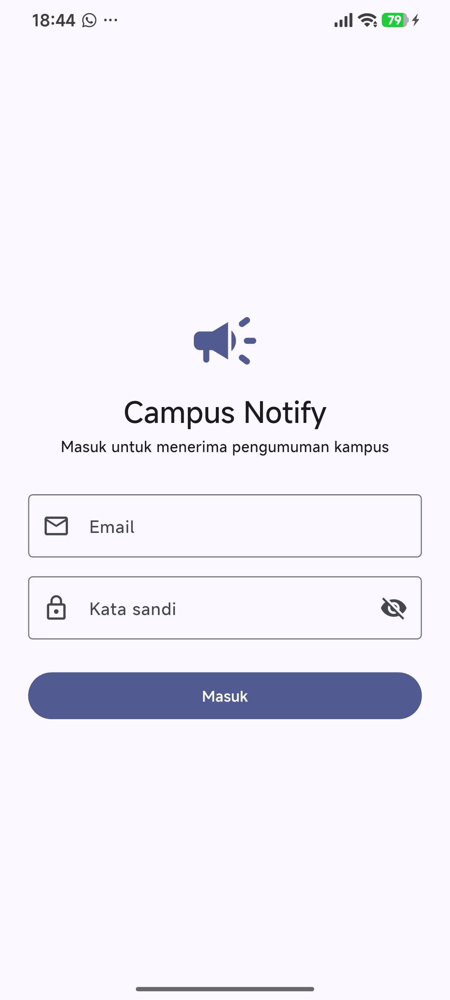 | 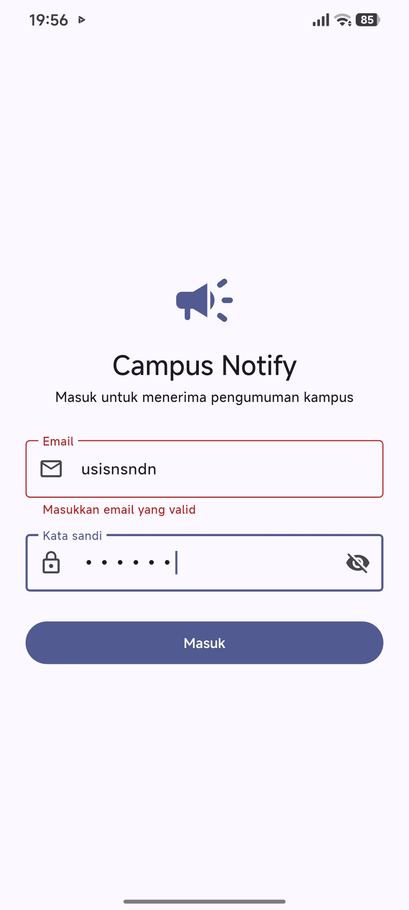 | 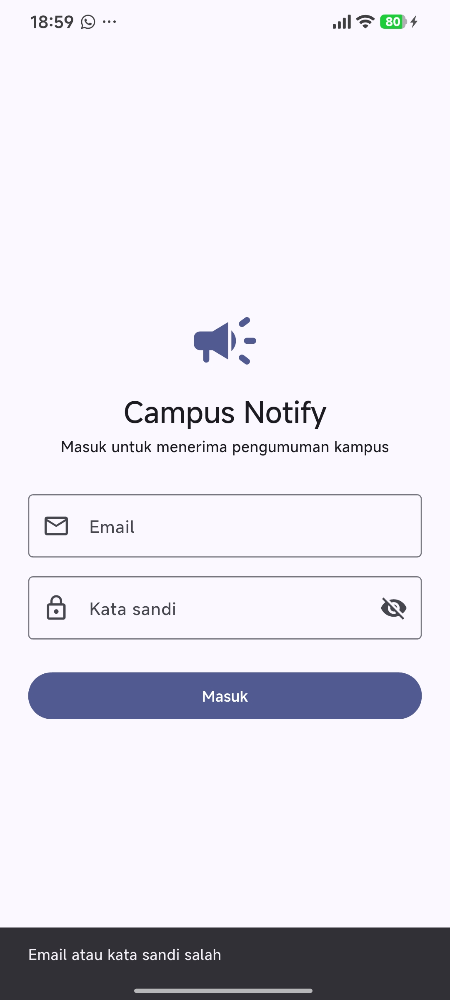 | 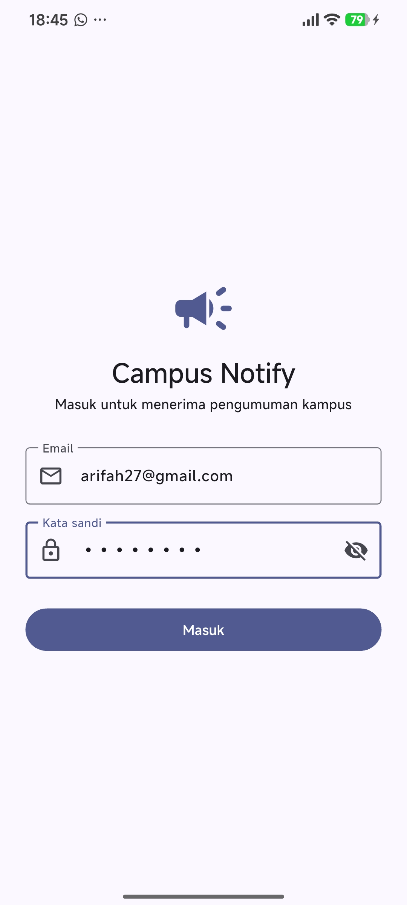 |

### B. Beranda & Status Notifikasi
| Beranda Berhasil Login | Token Berhasil Dimuat (Masked) | Pengujian Notifikasi Ditekan |
|:---:|:---:|:---:|
| 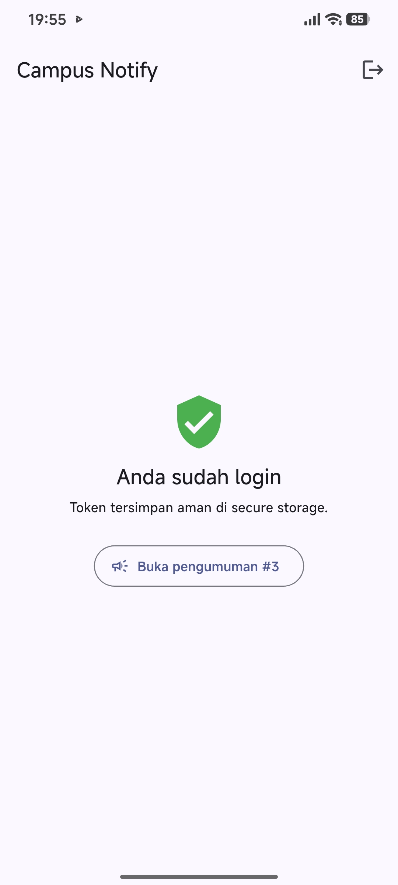 | 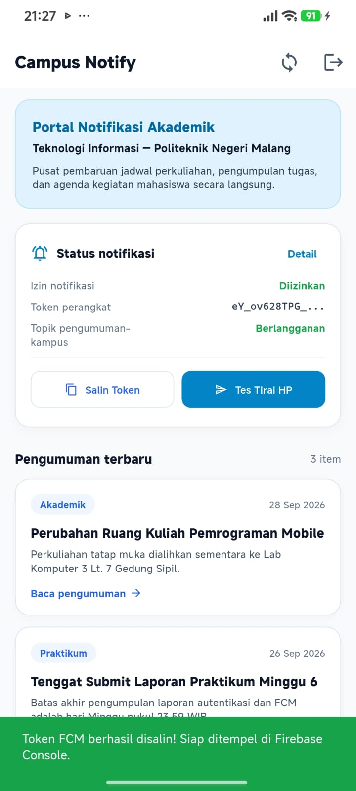 | 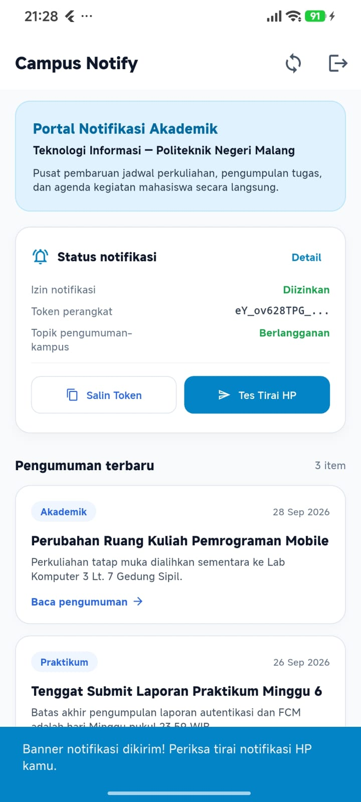 |

### C. Pengujian Tirai Notifikasi & Deep Linking
| Notifikasi Masuk di Tirai (Status Bar) | Banner Foreground Diterima | Halaman Daftar Pengumuman | Deep Link Detail Pengumuman (`/pengumuman/3`) |
|:---:|:---:|:---:|:---:|
| 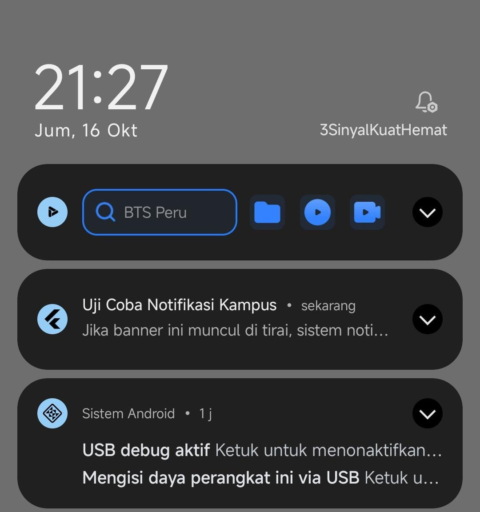 | 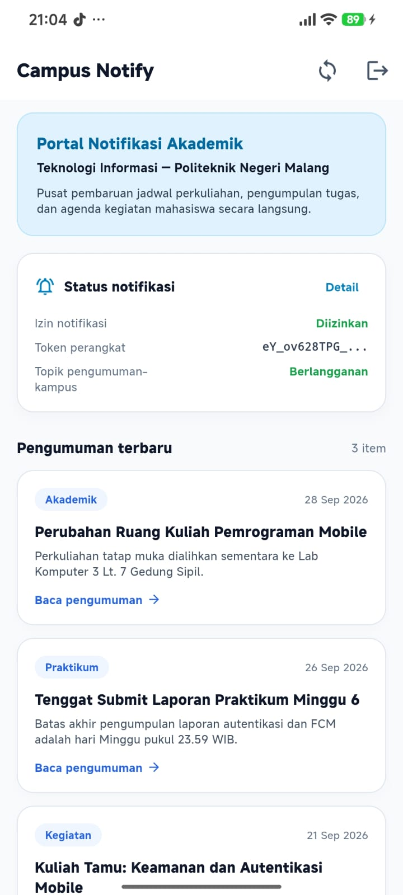 | 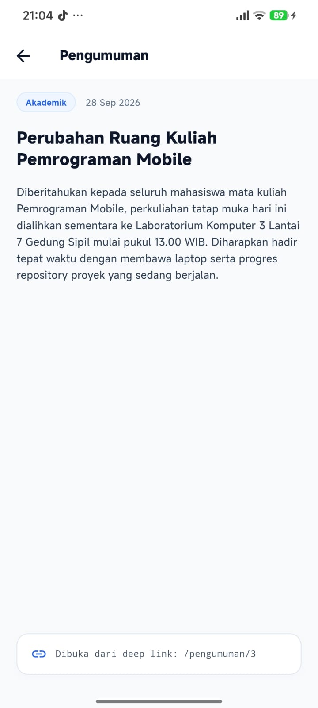 | 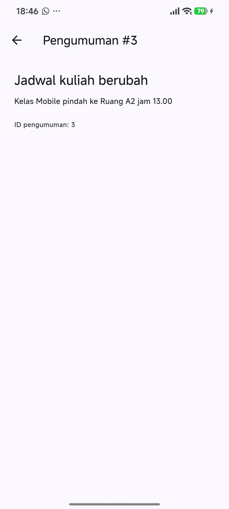 |

### D. Manajemen Kedaluwarsa Sesi (Auto-Logout)
| Kembali ke Layar Login Saat Sesi Berakhir |
|:---:|
| 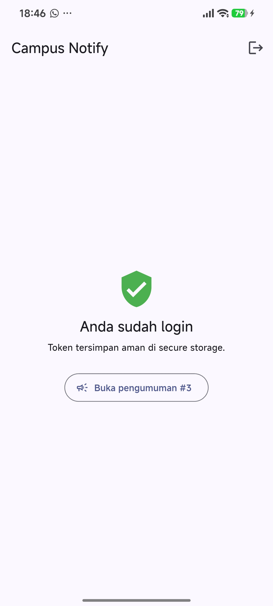 |

---

## 7. Hasil Analisis dan Pengujian Otomatis (CI/Test)

### 1. `flutter analyze`
```bash
$ flutter analyze
Analyzing campus_notify...
No issues found! (ran in 92.1s)
```
Status: **BERSIH (0 warning, 0 error)**

### 2. `flutter test`
```bash
$ flutter test
00:00 +0: routeFromMessage menangani route kosong dan tanpa slash
00:00 +1: data payload membawa id pengumuman
00:00 +2: provider auth membaca status login dari token
00:00 +3: refresh gagal -> sesi dibersihkan (paksa login ulang)
00:00 +4: ApiErrorHandler memetakan DioException ke pesan ramah pengguna
00:00 +5: All tests passed!
```
Status: **100% LULUS (5 dari 5 unit test berhasil)**

---

## 8. Usulan Clean Architecture (Minggu 7)

Catatan inspeksi source, rencana feature-first untuk auth dan announcements,
pemetaan file lama, keputusan use case, wiring DI Riverpod, dan checklist
verifikasi:
[docs/clean_architecture_proposal.md](campus_notify/docs/clean_architecture_proposal.md).
