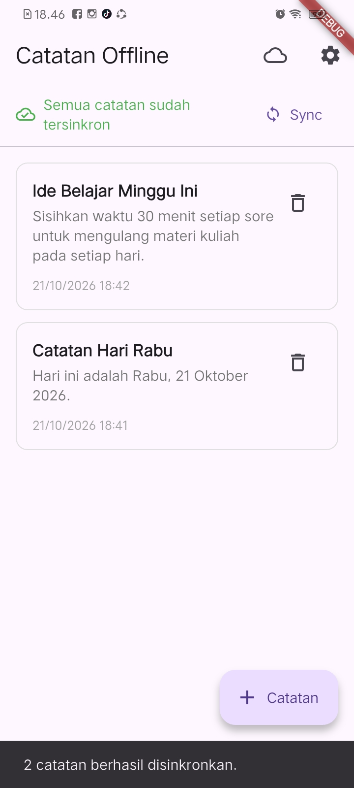
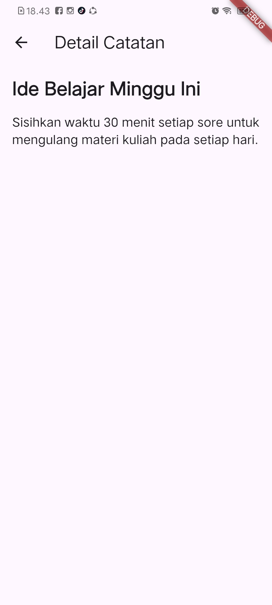
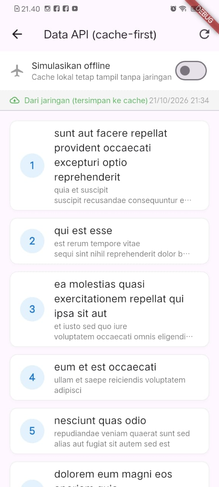

# Minggu 7 — Clean Architecture di Flutter

| | |
| --- | --- |
| **Nama** | Arifah Zhafirah Wikananda |
| **NIM** | 244107020188 |
| **Mata Kuliah** | Pemrograman Mobile |
| **Institusi** | Politeknik Negeri Malang |

## Daftar Isi

1. [Tujuan](#tujuan)
2. [Ringkasan Aplikasi](#ringkasan-aplikasi)
3. [Konsep Clean Architecture](#konsep-clean-architecture)
4. [Tanggung Jawab File Utama](#tanggung-jawab-file-utama)
5. [Entity, Model, Repository, dan Use Case](#entity-model-repository-dan-use-case)
6. [Dependency Injection dengan Riverpod](#dependency-injection-dengan-riverpod)
7. [Hasil Aplikasi](#hasil-aplikasi)
8. [Pengujian dan Analisis](#pengujian-dan-analisis)
9. [AI Verification Checklist](#ai-verification-checklist)
10. [Checklist Verifikasi Mandiri](#checklist-verifikasi-mandiri)
11. [Refleksi](#refleksi)

---

## Tujuan

Menerapkan pemisahan tanggung jawab pada aplikasi Flutter dengan membedakan lapisan *presentation*, *domain*, dan *data*. Latihan menggunakan aplikasi catatan offline untuk melihat alur data dari UI melalui provider dan kontrak repository hingga implementasi SQLite, serta menguji logika domain tanpa mengakses database sebenarnya.

## Ringkasan Aplikasi

Aplikasi mempertahankan fitur Offline Notes dari praktikum sebelumnya, lalu menambahkan contoh struktur *feature-first* untuk fitur notes.

| Bagian | Implementasi |
| --- | --- |
| Bahasa dan framework | Dart, Flutter |
| State management dan DI | Riverpod (`flutter_riverpod`) |
| Penyimpanan catatan | SQLite melalui `sqflite` |
| Penyimpanan preferensi | `SharedPreferences` |
| Data posts | REST API melalui Dio dengan cache SQLite |
| Navigasi | `go_router` |
| Testing | `flutter_test`, fake repository |

Fitur aplikasi meliputi CRUD catatan lokal, badge catatan yang belum tersinkron, simulasi sinkronisasi, pengaturan tema, dan tampilan posts dari cache saat offline.

## Konsep Clean Architecture

Kode dipisahkan berdasarkan tanggung jawab:

- **Presentation**: halaman, widget, dan provider/notifier untuk state UI. Lapisan ini menampilkan data serta meneruskan aksi pengguna.
- **Domain**: entity dan kontrak repository yang mendeskripsikan kebutuhan bisnis tanpa bergantung pada Flutter atau database.
- **Data**: implementasi repository dan model yang menangani detail SQLite, jaringan, serta pemetaan data.

Alur yang dituju:

```text
Widget / Page
    ↓ watch state atau panggil aksi
Riverpod provider / notifier
    ↓ menggunakan kontrak
Domain repository interface
    ↑ diimplementasikan oleh
Data repository implementation
    ↓
SQLite / REST API / penyimpanan lain
```

Riverpod juga berperan sebagai *dependency injection*: provider menjadi titik untuk memilih implementasi repository. Widget seharusnya hanya menggunakan provider/notifier, bukan membuat implementasi konkret atau membuka database secara langsung.

### Struktur yang ada di source

```text
lib/
├── core/
│   └── failures.dart
├── features/
│   └── notes/
│       ├── domain/
│       │   ├── entities/note.dart
│       │   ├── repositories/note_repository.dart
│       │   └── usecases/get_notes.dart
│       ├── data/
│       │   ├── models/note_model.dart
│       │   └── repositories/note_repository_impl.dart
│       └── presentation/
│           └── providers/notes_providers.dart
├── data/
│   ├── local/
│   ├── repositories/note_repository.dart
│   ├── prefs.dart
│   └── sync.dart
├── pages/
├── widgets/
└── main.dart
```

> **Catatan status implementasi:** struktur `features/notes` sudah berisi contoh lapisan domain, data, dan presentation, tetapi belum menjadi satu-satunya jalur yang digunakan aplikasi.
>
> - `NotesPage` masih mendefinisikan provider sendiri dan menggunakan repository lama di `lib/data/repositories/note_repository.dart`.
> - Provider feature ada di `features/notes/presentation/providers/notes_providers.dart`, sementara `GetNotes` saat ini dipakai dalam unit test, belum menjadi alur yang digunakan provider/halaman utama.
>
> Karena itu, pemisahan feature-first pada proyek ini masih berupa implementasi bertahap, bukan migrasi penuh.

## Tanggung Jawab File Utama

| File | Tanggung jawab |
| --- | --- |
| `lib/features/notes/domain/entities/note.dart` | Entity Note berisi data inti catatan; tidak berisi serialisasi Map/JSON. |
| `lib/features/notes/domain/repositories/note_repository.dart` | Kontrak operasi catatan dan tipe hasil yang dibutuhkan domain. |
| `lib/features/notes/domain/usecases/get_notes.dart` | Contoh use case untuk mengambil daftar catatan dengan mendelegasikan ke kontrak repository. |
| `lib/features/notes/data/models/note_model.dart` | Mapping field antara bentuk penyimpanan SQLite dan entity Note. |
| `lib/features/notes/data/repositories/note_repository_impl.dart` | Implementasi kontrak repository menggunakan SQLite dan `NoteModel`. |
| `lib/features/notes/presentation/providers/notes_providers.dart` | Wiring repository feature melalui Riverpod serta provider state dan aksi notes. |
| `lib/core/failures.dart` | Representasi kegagalan lokal/jaringan yang dapat digunakan di luar UI. |
| `lib/data/local/db.dart` | Inisialisasi database dan tabel SQLite. |
| `lib/data/repositories/note_repository.dart` | Repository lama yang masih digunakan sejumlah halaman; perlu dipertimbangkan saat migrasi penuh. |
| `lib/pages/notes_page.dart` | UI daftar, tambah, hapus, dan aksi sinkronisasi catatan. |
| `lib/pages/note_detail_page.dart` | UI detail; saat ini mengambil provider dari `notes_page.dart`, sehingga masih terikat pada struktur halaman lama. |
| `test/get_notes_test.dart` | Menguji use case dengan fake repository tanpa SQLite. |

## Entity, Model, Repository, dan Use Case

`Note` pada domain merepresentasikan catatan untuk aturan dan alur aplikasi. `NoteModel` bertanggung jawab pada konversi data penyimpanan melalui `fromMap`, `toMap`, dan `toEntity`; operasi mapping tidak diletakkan pada entity.

`NoteRepository` pada `features/notes/domain/repositories/` adalah abstraksi, sedangkan `NoteRepositoryImpl` pada `features/notes/data/repositories/` adalah implementasi SQLite. Pemisahan ini membuat domain tidak perlu mengetahui cara penyimpanan konkret dan memungkinkan implementasi diganti dengan fake saat tes.

`GetNotes` adalah contoh use case. Untuk operasi CRUD sederhana yang hanya meneruskan satu pemanggilan ke repository, use case satu-baris per operasi menambah boilerplate tanpa menambah aturan bisnis; repository dapat dipakai langsung oleh provider/notifier. Use case lebih berguna ketika sebuah aksi memiliki validasi atau kebijakan domain, mengoordinasikan beberapa repository, atau digunakan ulang oleh beberapa alur.

## Dependency Injection dengan Riverpod

Pola provider repository yang ada di feature:

```dart
final noteRepositoryProvider = Provider<NoteRepository>((ref) {
  return NoteRepositoryImpl(openDb: openNotesDb);
});
```

Provider bertipe interface domain, tetapi membangun implementasi data. Provider state kemudian memakai provider tersebut, sedangkan widget membaca provider state/aksi. Ini menjaga pembuatan dependency konkret di luar widget dan memudahkan *override* provider dengan fake dalam tes.

## Hasil Aplikasi

### CRUD Sebelum: catatan dan detail

| Daftar catatan dengan badge dirty | Daftar catatan setelah tersinkron | Form tambah catatan | Detail catatan |
| --- | --- | --- | --- |
|  |  |  |  |

### CRUD Sesudah: catatan dan detail

| Daftar catatan dengan badge dirty | Daftar catatan setelah tersinkron | Form tambah catatan | Detail catatan |
| --- | --- | --- | --- |
|  |  |  |  |

### Data posts

| Posts dari jaringan | Posts dari cache ketika refresh gagal |
| --- | --- |
|  |  |

### Tema dan preferensi

| Tema terang | Tema gelap |
| --- | --- |
|  |  |

## Pengujian dan Analisis

Jalankan perintah dari folder proyek:

```powershell
cd 07-week-7-clean-architecture/week5_offline_notes
flutter pub get
flutter analyze
flutter test
```

Screenshot hasil analisis dan test yang tersedia di folder modul menunjukkan `flutter analyze` selesai dengan `No issues found!` dan `flutter test` selesai dengan `All tests passed!`.


Unit test `GetNotes` menggunakan `FakeNoteRepository`, sehingga skenario data berhasil, daftar kosong, dan failure dapat diuji tanpa database SQLite. Hasil ini menguji use case secara terisolasi; belum membuktikan bahwa halaman utama telah berpindah ke jalur provider feature-first.

## AI Verification Checklist

| Butir Evaluasi Checklist | Status | Bukti / Catatan Teknis |
| :--- | :---: | :--- |
| Interface repository di domain, implementasi di data | ✅ LOLOS | Interface `AuthRepository` diletakkan di `features/auth/domain/repositories/`, sedangkan `AuthRepositoryImpl` di `features/auth/data/repositories/`. Keduanya berada di layer terpisah. |
| Domain bebas Flutter / Dio / SQLite / Firebase | ✅ LOLOS | Seluruh file di `domain/` hanya mengimpor *pure Dart* (`failures.dart`, entitas dasar). Dapat diverifikasi dengan *grep*: tidak ada import library pihak ketiga. |
| Tidak ada use case 1-baris *pass-through* pada CRUD biasa | ✅ LOLOS | Fitur `announcements` tidak membuat use case artifisial. Repository interface langsung dikonsumsi Riverpod notifier, dengan alasan tertulis di poin 3. |
| Entity bebas mapping (`toMap`/`fromMap`/`toJson`) | ✅ LOLOS | Class `User` dan `Announcement` di domain murni tanpa method mapping. `fromJson` dan `toJson` diisolasi di `UserModel` (data layer). |
| Wiring DI terpusat & widget tidak `new Repository()` | ✅ LOLOS | Semua objek disuntikkan via `Provider<T>` Riverpod. Widget hanya `ConsumerWidget` dan menggunakan `ref.watch()`. |

## Checklist Verifikasi Mandiri

| Checklist | Status | Keterangan |
| :--- | :---: | :--- |
| Grep 1: presentation steril dari data mentah (`Dio(`, `openDatabase`, `getDatabasesPath`, `FlutterSecureStorage`, `SharedPreferences.getInstance`, `jsonDecode`) | ✅ Lolos | 0 temuan di `lib/features/notes/presentation`. Presentation hanya mengonsumsi state dari provider Riverpod. |
| Grep 2: domain dan core steril dari framework/package (`flutter`, `dio`, `sqflite`, `firebase`) | ✅ Lolos | 0 temuan di `lib/features/notes/domain` dan `lib/core`. Domain murni Dart. |
| Grep 3: tidak ada instansiasi manual (`Repository(`, `Dio(BaseOptions`) di presentation | ✅ Lolos | 0 temuan. Semua dependensi disuntikkan lewat provider. |
| Interface di domain, implementasi di data, mapping hanya di model | ✅ Lolos | `NoteRepository` ada di `domain/repositories`. `NoteRepositoryImpl` dan `NoteModel` (`toMap`, `fromMap`, `toEntity`) ada di `data`. Entity `Note` bebas mapping. |
| Widget tidak menginstansiasi repository; semua lewat provider | ✅ Lolos | Wiring DI terpusat di `notes_providers.dart`. `NotesPage` hanya memakai `ConsumerWidget` dan `ref.watch(notesProvider)`. |
| `flutter analyze` bersih | ✅ Lolos | `No issues found!` |
| Semua `flutter test` lulus | ✅ Lolos | 3 test lulus: meneruskan daftar, meneruskan failure tanpa melempar, dan daftar kosong. |
| Aplikasi berjalan identik sebelum dan sesudah refactor (bukti screenshot) | ✅ Lolos | Screenshot sudah disertakan di atas. |

## Refleksi

| Pertanyaan | Jawaban |
| :--- | :--- |
| Mengapa interface repository harus tinggal di domain, bukan di data? Apa yang rusak bila dibalik? | Ini berakar pada *Dependency Inversion Principle* dan *dependency rule*: domain (aturan bisnis inti) tidak boleh bergantung pada detail teknis seperti SQLite, Dio, atau Firebase. Interface repository adalah kebutuhan domain, dan domain tidak peduli data berasal dari API, SQLite, atau cache.<br><br>**Bila dibalik (interface di data):**<br>1. Arah dependensi terbalik, karena domain terpaksa mengimpor folder `data/`.<br>2. Berpotensi terjadi *circular dependency*, karena data butuh entity dari domain sedangkan domain butuh interface dari data.<br>3. Domain tidak bisa diuji murni tanpa menyertakan layer data, dan tidak bisa dipisah menjadi package Dart mandiri.<br>4. Mengganti teknologi (misal SQLite ke Hive atau Supabase) berisiko merusak domain. |
| Kapan use case benar-benar dibutuhkan, dan kapan repository langsung ke notifier sudah cukup? | **Repository langsung ke notifier cukup** untuk CRUD 1:1 sederhana tanpa aturan bisnis tambahan (misal `fetchAnnouncements()`, `deleteNote(id)`). Use case satu baris hanya *boilerplate* kosong, dan `AsyncNotifier` atau `FutureProvider` sudah cukup sebagai presenter.<br><br>**Use case dibutuhkan bila:**<br>1. Ada orkestrasi multi-repository atau service, misalnya alur login lalu ambil token FCM, daftarkan token ke backend, dan simpan sesi.<br>2. Ada aturan dan validasi bisnis murni, misalnya kelayakan KRS (IPK, prasyarat, kuota) yang harus bisa diuji tanpa UI atau database.<br>3. Ada koordinasi *offline-first* dan resolusi konflik, misalnya cek flag *dirty*, strategi *last-write-wins* berdasarkan `updated_at`, dan keputusan simpan lokal atau unggah ke cloud. |
| Apa biaya *over-engineering* (use case per CRUD satu-baris) bagi tim kecil? Kapan biayanya sepadan? | **Biaya bagi tim kecil:**<br>1. Jumlah file membengkak: 4 operasi CRUD berarti 4 use case, 4 provider, dan 4 file test, sehingga navigasi kode melelahkan.<br>2. Perubahan skema merepotkan: menambah satu parameter (misal filter category) berarti mengubah 5 tempat (entity, interface, use case, implementasi, notifier/UI).<br>3. Tes sia-sia: use case satu baris hanya menguji "method memanggil method repo", bukan logika bisnis.<br><br>**Biaya sepadan bila:**<br>• Tim besar (>10-15 developer), sehingga tim domain dan UI bisa bekerja paralel dengan kontrak use case yang jelas.<br>• Domain bisnis rumit dan kritis (perbankan, pembayaran, logistik) dengan aturan yang sering berubah dan perlu audit independen. |
| Bagian mana dari usulan AI yang Anda tolak atau sederhanakan, dan mengapa? | 1. **Use case untuk setiap CRUD** (`GetAnnouncements`, `GetAnnouncementDetail`): ditolak. Repository langsung dihubungkan ke Riverpod notifier, karena kelas *pass-through* tanpa logika bisnis hanya menambah *boilerplate*.<br>2. **Package DI tambahan** (`get_it`, `injectable`): ditolak. Cukup memakai provider bawaan Riverpod, yang sudah menjadi IoC container *type-safe* dengan *lifecycle dispose* dan *mocking* via `ProviderScope(overrides: [...])`, sehingga `get_it` redundan.<br>3. **Layer `RemoteDataSource` dan `LocalDataSource` untuk notes lokal:** disederhanakan. `openNotesDb` disuntikkan langsung ke `NoteRepositoryImpl`, karena fitur notes 100% SQLite lokal dan perantara hanya menambah lapisan tipis tanpa nilai. Pemisahan data source baru dibuat bila ada integrasi remote (Dio).<br>4. **Library fungsional `fpdart` atau `dartz`** (`Either<Failure, T>`): disederhanakan. Memakai Dart 3 Records (`{T? data, Failure? failure}`) yang ringan, tanpa dependensi pihak ketiga, dan lebih mudah dibaca serta dipelihara. |
