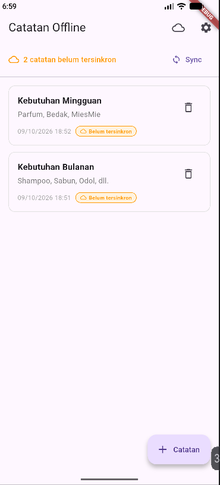
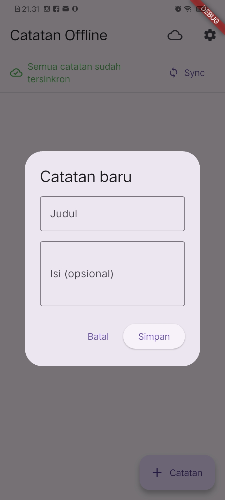
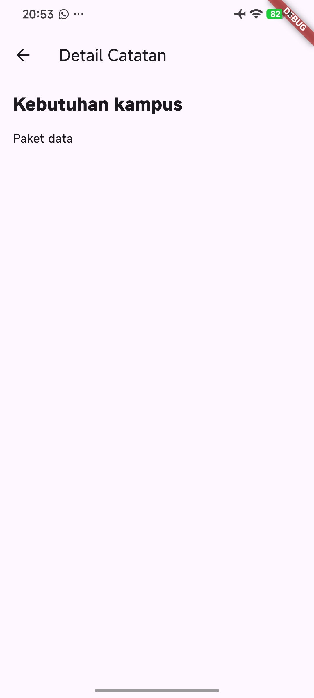
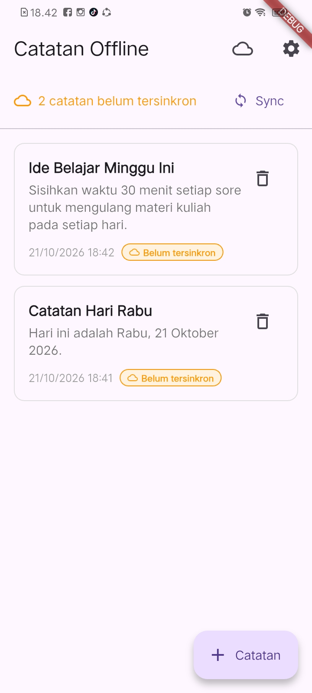
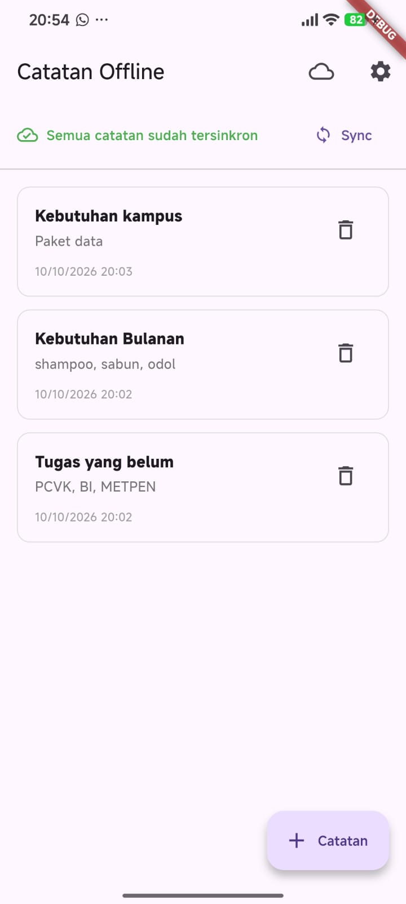
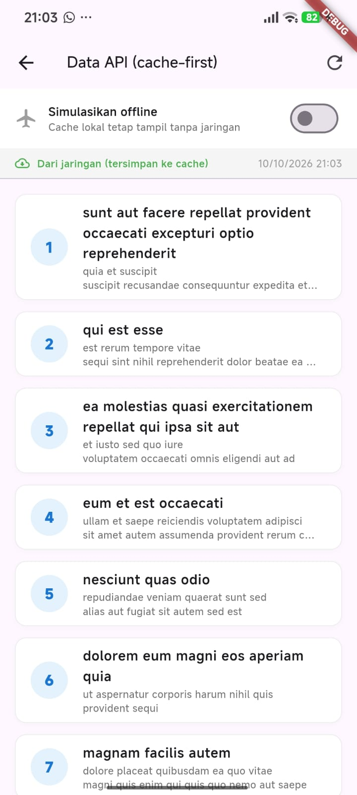
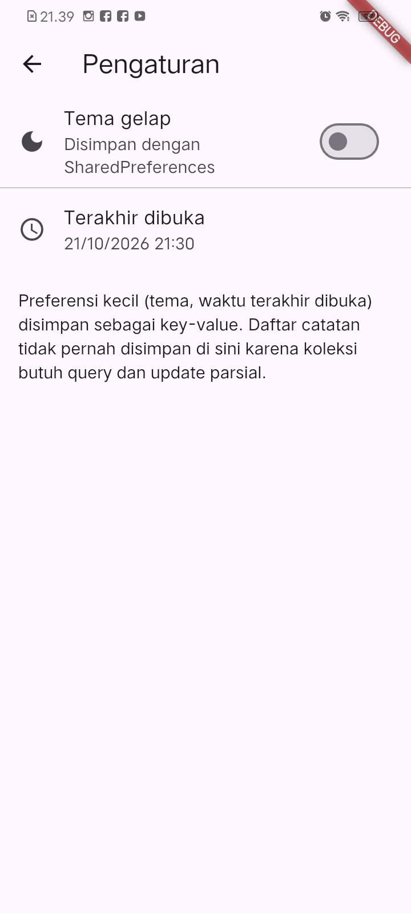
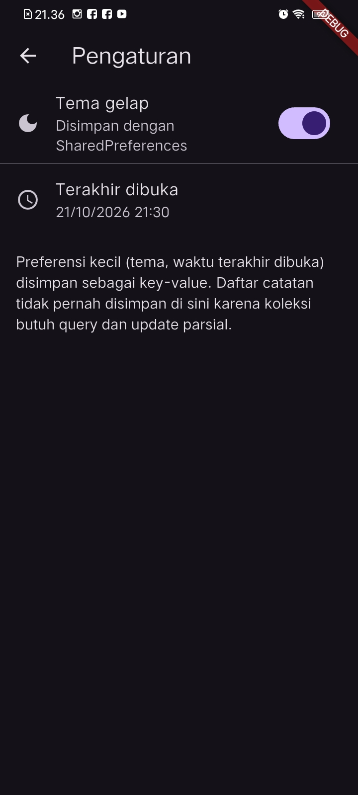
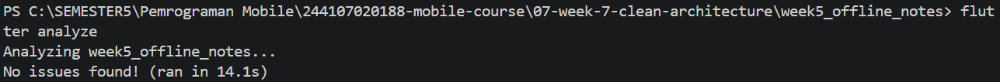
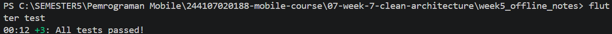

# Minggu 7 — Clean Architecture di Flutter

**Nama:** Arifah Zhafirah Wikananda  
**NIM:** 244107020188  
**Mata Kuliah:** Pemrograman Mobile — Politeknik Negeri Malang  
**Proyek:** Offline Notes (`week5_offline_notes`)

> Materi: [Codelab Minggu 7 — Clean Architecture](https://jti-polinema.github.io/flutter-codelab/07-minggu-7-clean-architecture/index.html#0)

## Tujuan

Menerapkan pemisahan tanggung jawab pada aplikasi Flutter dengan membedakan
lapisan presentation, domain, dan data. Latihan menggunakan aplikasi catatan
offline untuk melihat alur data dari UI melalui provider dan kontrak repository
hingga implementasi SQLite, serta menguji logika domain tanpa mengakses database
sebenarnya.

## Ringkasan Aplikasi

Aplikasi mempertahankan fitur Offline Notes dari praktikum sebelumnya, lalu
menambahkan contoh struktur feature-first untuk fitur notes.

| Bagian | Implementasi |
| --- | --- |
| Bahasa dan framework | Dart, Flutter |
| State management dan DI | Riverpod (`flutter_riverpod`) |
| Penyimpanan catatan | SQLite melalui `sqflite` |
| Penyimpanan preferensi | `SharedPreferences` |
| Data posts | REST API melalui Dio dengan cache SQLite |
| Navigasi | `go_router` |
| Testing | `flutter_test`, fake repository |

Fitur aplikasi meliputi CRUD catatan lokal, badge catatan yang belum tersinkron,
simulasi sinkronisasi, pengaturan tema, dan tampilan posts dari cache saat
offline.

## Konsep Clean Architecture

Kode dipisahkan berdasarkan tanggung jawab:

- **Presentation**: halaman, widget, dan provider/notifier untuk state UI.
  Lapisan ini menampilkan data serta meneruskan aksi pengguna.
- **Domain**: entity dan kontrak repository yang mendeskripsikan kebutuhan
  bisnis tanpa bergantung pada Flutter atau database.
- **Data**: implementasi repository dan model yang menangani detail SQLite,
  jaringan, serta pemetaan data.

Alur yang dituju:

```text
Widget / Page
    ↓ watch state atau panggil aksi
Riverpod provider / notifier
    ↓ menggunakan kontrak
Domain repository interface
    ↑ diimplementasikan oleh
Data repository implementation
    ↓
SQLite / REST API / penyimpanan lain
```

Riverpod juga berperan sebagai dependency injection: provider menjadi titik
untuk memilih implementasi repository. Widget seharusnya hanya menggunakan
provider/notifier, bukan membuat implementasi konkret atau membuka database
secara langsung.

### Struktur yang ada di source

```text
lib/
├── core/
│   └── failures.dart
├── features/
│   └── notes/
│       ├── domain/
│       │   ├── entities/note.dart
│       │   ├── repositories/note_repository.dart
│       │   └── usecases/get_notes.dart
│       ├── data/
│       │   ├── models/note_model.dart
│       │   └── repositories/note_repository_impl.dart
│       └── presentation/
│           └── providers/notes_providers.dart
├── data/
│   ├── local/
│   ├── repositories/note_repository.dart
│   ├── prefs.dart
│   └── sync.dart
├── pages/
├── widgets/
└── main.dart
```

**Catatan status implementasi:** struktur `features/notes` sudah berisi contoh
lapisan domain, data, dan presentation, tetapi belum menjadi satu-satunya jalur
yang digunakan aplikasi. `NotesPage` masih mendefinisikan provider sendiri dan
menggunakan repository lama di `lib/data/repositories/note_repository.dart`.
Provider feature ada di `features/notes/presentation/providers/notes_providers.dart`,
sementara `GetNotes` saat ini dipakai dalam unit test, belum menjadi alur yang
digunakan provider/halaman utama. Karena itu, pemisahan feature-first pada
proyek ini masih berupa implementasi bertahap, bukan migrasi penuh.

## Tanggung Jawab File Utama

| File | Tanggung jawab |
| --- | --- |
| `lib/features/notes/domain/entities/note.dart` | Entity Note berisi data inti catatan; tidak berisi serialisasi Map/JSON. |
| `lib/features/notes/domain/repositories/note_repository.dart` | Kontrak operasi catatan dan tipe hasil yang dibutuhkan domain. |
| `lib/features/notes/domain/usecases/get_notes.dart` | Contoh use case untuk mengambil daftar catatan dengan mendelegasikan ke kontrak repository. |
| `lib/features/notes/data/models/note_model.dart` | Mapping field antara bentuk penyimpanan SQLite dan entity Note. |
| `lib/features/notes/data/repositories/note_repository_impl.dart` | Implementasi kontrak repository menggunakan SQLite dan `NoteModel`. |
| `lib/features/notes/presentation/providers/notes_providers.dart` | Wiring repository feature melalui Riverpod serta provider state dan aksi notes. |
| `lib/core/failures.dart` | Representasi kegagalan lokal/jaringan yang dapat digunakan di luar UI. |
| `lib/data/local/db.dart` | Inisialisasi database dan tabel SQLite. |
| `lib/data/repositories/note_repository.dart` | Repository lama yang masih digunakan sejumlah halaman; perlu dipertimbangkan saat migrasi penuh. |
| `lib/pages/notes_page.dart` | UI daftar, tambah, hapus, dan aksi sinkronisasi catatan. |
| `lib/pages/note_detail_page.dart` | UI detail; saat ini mengambil provider dari `notes_page.dart`, sehingga masih terikat pada struktur halaman lama. |
| `test/get_notes_test.dart` | Menguji use case dengan fake repository tanpa SQLite. |

## Entity, Model, Repository, dan Use Case

`Note` pada domain merepresentasikan catatan untuk aturan dan alur aplikasi.
`NoteModel` bertanggung jawab pada konversi data penyimpanan melalui
`fromMap`, `toMap`, dan `toEntity`; operasi mapping tidak diletakkan pada
entity.

`NoteRepository` pada `features/notes/domain/repositories/` adalah abstraksi,
sedangkan `NoteRepositoryImpl` pada `features/notes/data/repositories/` adalah
implementasi SQLite. Pemisahan ini membuat domain tidak perlu mengetahui cara
penyimpanan konkret dan memungkinkan implementasi diganti dengan fake saat tes.

`GetNotes` adalah contoh use case. Untuk operasi CRUD sederhana yang hanya
meneruskan satu pemanggilan ke repository, use case satu-baris per operasi
menambah boilerplate tanpa menambah aturan bisnis. Repository dapat dipakai
langsung oleh provider/notifier. Use case lebih berguna ketika sebuah aksi
memiliki validasi atau kebijakan domain, mengoordinasikan beberapa repository,
atau digunakan ulang oleh beberapa alur.

## Dependency Injection dengan Riverpod

Pola provider repository yang ada di feature:

```dart
final noteRepositoryProvider = Provider<NoteRepository>((ref) {
  return NoteRepositoryImpl(openDb: openNotesDb);
});
```

Provider bertipe interface domain, tetapi membangun implementasi data.
Provider state kemudian memakai provider tersebut, sedangkan widget membaca
provider state/aksi. Ini menjaga pembuatan dependency konkret di luar widget dan
memudahkan override provider dengan fake dalam tes.

## Hasil Aplikasi

### CRUD catatan dan detail

| Daftar catatan dengan badge dirty | Form tambah catatan | Detail catatan |
| --- | --- | --- |
|  |  |  |

### Sinkronisasi dan cache offline

| Badge sebelum sinkronisasi | Catatan setelah sinkronisasi | Posts dari cache saat offline |
| --- | --- | --- |
|  |  |  |

| Posts dari jaringan | Posts dari cache ketika refresh gagal |
| --- | --- |
|  |  |

### Tema dan preferensi

| Tema terang | Tema gelap |
| --- | --- |
|  |  |

## Pengujian dan Analisis

Jalankan perintah dari folder proyek:

```powershell
cd 07-week-7-clean-architecture/week5_offline_notes
flutter pub get
flutter analyze
flutter test
```

Screenshot hasil analisis dan test yang tersedia di folder modul menunjukkan
`flutter analyze` selesai dengan `No issues found!` dan `flutter test` selesai
dengan `All tests passed!`.





Unit test `GetNotes` menggunakan `FakeNoteRepository`, sehingga skenario data
berhasil, daftar kosong, dan failure dapat diuji tanpa database SQLite. Hasil
ini menguji use case secara terisolasi; belum membuktikan bahwa halaman utama
telah berpindah ke jalur provider feature-first.

## AI Verification Checklist

> **Bagian ini sengaja disediakan untuk diisi sendiri.** Tambahkan hasil
> pemeriksaan source, perintah grep yang dijalankan, path/nomor baris, screenshot
> atau bukti lain, serta keputusan akhir.

| Poin verifikasi | Status | Bukti pemeriksaan (file/baris/perintah/screenshot) | Temuan dan keputusan |
| --- | --- | --- | --- |
| Interface repository berada di `domain`, implementasi repository berada di `data`. |  |  |  |
| Folder domain tidak mengimpor Flutter, Dio, SQLite, Firebase, atau package infrastruktur lain. |  |  |  |
| Use case tidak dibuat satu per satu untuk CRUD sederhana tanpa aturan tambahan. |  |  |  |
| Entity tidak berisi mapping seperti `toMap`, `fromMap`, `toJson`, atau `fromJson`; mapping berada di model data. |  |  |  |
| Wiring DI terpusat pada provider Riverpod dan widget tidak membuat repository konkret. |  |  |  |
| Perintah grep dan bukti screenshot yang mendukung pemeriksaan. |  |  |  |
| Keputusan akhir dan alasan teknis. |  |  |  |

## Checklist Verifikasi Mandiri

> **Isi status dan bukti setelah verifikasi manual.** Jangan menandai selesai
> sebelum memeriksa implementasi dan menjalankan pengujian yang relevan.

| Checklist | Status | Bukti/catatan |
| --- | --- | --- |
| Kontrak repository berada di domain dan implementasi berada di data. |  |  |
| Domain bebas dari dependency framework dan teknologi penyimpanan/jaringan. |  |  |
| Mapping data hanya berada di model data, bukan entity. |  |  |
| Provider Riverpod menjadi tempat wiring dependency; UI memakai provider/notifier. |  |  |
| CRUD sederhana tidak memiliki use case satu-baris yang tidak memberi aturan baru. |  |  |
| Unit test menggunakan dependency fake dan mencakup hasil sukses serta error. |  |  |
| `flutter analyze` dan `flutter test` sudah dijalankan; hasil/bukti dicatat. |  |  |

## Refleksi

> **Jawab sendiri berdasarkan hasil pemeriksaan dan keputusan implementasi.**

1. Bagian mana dari Clean Architecture yang paling membantu pemisahan tanggung
   jawab pada aplikasi ini, dan trade-off apa yang muncul?

   **Jawaban:**

2. Mengapa interface repository sebaiknya berada di domain dan implementasinya
   di data? Bagaimana batas dependency tersebut diperiksa pada source?

   **Jawaban:**

3. Kapan repository langsung dari provider sudah cukup, dan kapan use case
   benar-benar dibutuhkan?

   **Jawaban:**

4. Apakah semua layar aplikasi sudah menggunakan jalur arsitektur feature-first?
   Jika belum, bagian mana yang masih perlu dimigrasikan?

   **Jawaban:**

5. Apa keputusan akhir terkait entity, model, Riverpod sebagai DI, dan alasan
   teknis di balik keputusan tersebut?

   **Jawaban:**
