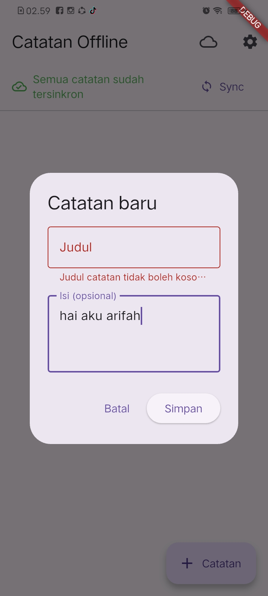

# 08 | Mid Project Review & Code Review

## Ringkasan

| Komponen | Keterangan |
| --- | --- |
| Minggu | 8 |
| Topik | Mid Project Review, hygiene branch/commit, Pull Request, peer review, static analysis, testing, dan AI review |
| Project yang direview | `week5_offline_notes` — aplikasi Offline Notes lanjutan dari project Minggu 5 |
| Stack | Flutter/Dart, Riverpod, GoRouter, SQLite (`sqflite`), Dio, SharedPreferences, Flutter Test |
| Status paruh semester | PR validasi judul #1 telah merged ke `develop`; refactor dan bukti uji lokal tersedia di workspace. Checklist kesiapan codelab belum terisi seluruhnya, uji manual belum dilakukan, dan status CI GitHub belum terverifikasi. |

Praktikum ini meneruskan project yang sudah ada, bukan membuat aplikasi baru. Fokus review adalah kebenaran perilaku, batas arsitektur, kualitas test, dan bukti bahwa perubahan dapat dianalisis serta diuji.

## Struktur folder

```text
08-week-8-mid-project-review-code-review/
├── docs/
│   ├── ai-review-vs-keputusan.md
│   ├── bukti-uji.md
│   ├── error-umum.md
│   ├── peer-review.md
│   ├── pr-template.md
│   └── review-checklist.md
├── screenshots/
│   └── 1_validasi_judul_kosong.jpeg
├── week5_offline_notes/
│   ├── lib/
│   ├── test/
│   └── pubspec.yaml
└── README.md
```

Workflow CI berada di root repository pada [`.github/workflows/ci.yml`](../.github/workflows/ci.yml), bukan di dalam folder codelab. File ini menjalankan analyze, format check, dan test untuk perubahan Minggu 8; belum ada bukti run GitHub Actions pada dokumentasi yang diperiksa.

## Fitur utama dan stack teknologi

Project yang direview adalah aplikasi **Offline Notes**. Catatan disimpan secara lokal dengan SQLite, ditampilkan dalam daftar dan halaman detail, serta dapat ditambah atau dihapus. Aplikasi juga memiliki status sinkronisasi catatan, cache posts dari JSONPlaceholder melalui Dio, pengaturan tema/preferensi, Riverpod untuk state, dan GoRouter untuk navigasi.

| Teknologi | Peran |
| --- | --- |
| Flutter dan Dart | UI dan bahasa aplikasi |
| Riverpod | State management dan dependency injection |
| GoRouter | Navigasi halaman |
| SQLite (`sqflite`) | Penyimpanan catatan lokal dan cache |
| Dio | Request HTTP untuk data posts |
| SharedPreferences | Penyimpanan preferensi aplikasi |
| Flutter Test | Unit test dan widget test |

Alur notes utama di workspace telah dipindahkan ke provider/entity pada `features/notes`; repository lama masih digunakan oleh alur sinkronisasi. Karena itu, migrasi feature-first belum mencakup semua subsystem aplikasi.

## Cara menjalankan

Dari root repository:

```powershell
cd 08-week-8-mid-project-review-code-review\week5_offline_notes
flutter pub get
flutter run
```

Analisis dan test:

```powershell
flutter analyze
dart format --set-exit-if-changed lib test
flutter test
```

## Praktikum 1 — Hygiene branch dan commit

### Hasil audit

Audit yang didokumentasikan di [`docs/review-checklist.md`](docs/review-checklist.md) dilakukan pada 25 Oktober 2026 di branch `feat/notes-validation`. Catatan audit menyebut 16 commit yang diperiksa dan commit terbaru `ba29434 Revise README for Clean Architecture project`. Ringkasan log tidak cukup untuk menyimpulkan apakah semua perubahan masuk melalui PR atau pernah dilakukan commit langsung ke `main`; umur branch fitur juga tidak dapat dipastikan dari bukti tersebut. Worktree dicatat bersih pada saat audit.

### Simulasi perbaikan pesan commit

Tabel ini merupakan **usulan pesan yang lebih deskriptif**, bukan klaim bahwa commit historis telah diubah.

| Pesan sebelum | Usulan pesan sesudah | Status |
| --- | --- | --- |
| `Praktikum 7 done` | `feat(notes): tambahkan aplikasi offline notes dan struktur awal` | Simulasi di checklist, bukan rewrite commit |
| `Update README.md` | `docs(week5): perbarui panduan proyek penyimpanan offline` | Simulasi di checklist, bukan rewrite commit |
| `Add files via upload` | `docs(campus-notify): tambahkan bukti screenshot praktikum` | Simulasi di checklist, bukan rewrite commit |

### Kode validasi dan test

Use case `ValidateNote` menolak judul kosong maupun judul yang hanya berisi whitespace dengan memeriksa `trim()`. Input valid diterima. Test mencakup kasus kosong, whitespace, judul valid, judul valid yang diapit spasi, serta perilaku dialog saat validasi gagal. Widget test tambahan menguji bahwa judul valid diteruskan ke repository dan kegagalan simpan menampilkan pesan aman.

## Praktikum 2 — PR dan peer review

### Template PR

Template deskripsi siap pakai tersimpan di [`docs/pr-template.md`](docs/pr-template.md). Isinya mencakup masalah, solusi, cara uji, tautan issue, dan tempat untuk screenshot. Template itu menggambarkan PR validasi judul dan tidak menjadi bukti bahwa screenshot placeholder di template sudah terisi.

### Ringkasan review

Lembar [`docs/peer-review.md`](docs/peer-review.md) menyediakan kategori kebenaran, arsitektur, test, dan keterbacaan, contoh komentar kurang/baik, serta tabel tindak lanjut self-review. Tidak ada komentar reviewer sejawat yang disertakan dalam bahan yang diperiksa; tabel tindak lanjut yang terisi bersumber dari self-review, bukan komentar pasangan.

PR validasi judul tercatat sebagai PR #1, dari `feat/notes-validation` ke `develop`, dan telah merged. PR tersebut memiliki judul `feat(notes): validasi judul kosong + test` dan body yang merujuk `Closes #3`. Status issue #3 tidak diperiksa secara terpisah di sini.

## Praktikum 3 — Static analysis dan mid review

### Hasil lokal terbaru yang tercatat

| Pemeriksaan | Hasil |
| --- | --- |
| `flutter analyze` | `No issues found!` |
| `dart format --set-exit-if-changed lib test` | `Formatted 22 files (0 changed)` |
| `flutter test` | `All tests passed!` — 13 test |
| Uji manual | Belum dilakukan |
| GitHub Actions | Workflow tersedia; hasil run belum terverifikasi |

Output lengkap, termasuk catatan bahwa analyzer pertama kali gagal ketika dijalankan paralel dengan test lalu berhasil saat diulang terpisah, ada di [`docs/bukti-uji.md`](docs/bukti-uji.md). Baris log kegagalan simpan yang muncul selama test berasal dari fake repository pada skenario error; proses test berakhir dengan seluruh 13 test lulus.

### CI

Workflow [`.github/workflows/ci.yml`](../.github/workflows/ci.yml) menjalankan `flutter pub get`, `flutter analyze`, `dart format --set-exit-if-changed lib test`, dan `flutter test` pada pull request yang menyentuh workflow atau folder Minggu 8. Ini menambahkan pemeriksaan otomatis agar format, analisis, atau test yang gagal dapat menahan PR. Keberadaan file workflow sudah diperiksa, tetapi status check GitHub belum dibuktikan.

### Checklist kesiapan

Tabel checklist di [`docs/review-checklist.md`](docs/review-checklist.md) belum diisi. Bukti lokal analyzer, format, dan test tersedia di [`docs/bukti-uji.md`](docs/bukti-uji.md), tetapi persetujuan peer review, hasil uji manual, dan hasil CI belum dapat dinyatakan selesai.

## Peta issue dan PR

| Issue/PR | Judul | Branch | Status yang terbukti | Link |
| --- | --- | --- | --- | --- |
| Issue #3 | Validasi judul kosong — dirujuk sebagai `Closes #3` pada body PR | — | Direferensikan oleh PR #1; status issue tidak diverifikasi terpisah | [Issue #3](https://github.com/ArifahZhafirah/244107020188-mobile-course/issues/3) |
| PR #1 | `feat(notes): validasi judul kosong + test` | `feat/notes-validation` → `develop` | Merged; PR mencatat 225 additions dan 32 deletions | [PR #1](https://github.com/ArifahZhafirah/244107020188-mobile-course/pull/1) |
| PR refactor/CI setelah PR #1 | Belum ada judul/nomor PR dalam bukti yang diperiksa | Belum diverifikasi | Belum dapat dinyatakan sudah dibuat atau merged | — |

## AI Challenge

Prompt yang digunakan:

> Review PR Flutter ini sebagai senior Flutter dev.  
> Konteks: feature-first Clean Architecture (presentation -> domain <- data), Riverpod, GoRouter, SQLite + Dio.  
> Fokus: kebenaran, arsitektur, dan test. Abaikan style.  
> Berikan 5 temuan teratas + level (blocker/saran) + alasan + usulan potongan kode perbaikan.

Kelima temuan awal diklasifikasikan sebagai saran, bukan blocker. Ringkasan keputusan berikut bersumber dari [`docs/ai-review-vs-keputusan.md`](docs/ai-review-vs-keputusan.md), yang memuat bukti grep pada kode dan test.

| No. | Temuan AI | Verifikasi/keputusan |
| --- | --- | --- |
| 1 | Halaman notes masih memakai jalur lama sementara provider feature-first tersedia terpisah. | Terbukti dari route/provider; diterima dan CRUD utama dipindahkan ke provider feature-first. Repository legacy masih dipakai sinkronisasi. |
| 2 | Aksi tambah pada provider feature tidak memvalidasi judul. | Method tersebut memang memanggil repository tanpa validasi. Dampak sebagai bug di alur aktif ditolak secara terbatas karena halaman aktif saat review AI memakai form validator; dicatat sebagai risiko sebelum provider dipakai. |
| 3 | Use case domain mengembalikan string pesan UI. | Terbukti; diterima sebagai perbaikan arsitektur bila cakupan pesan/lokalisasi berkembang. |
| 4 | Error penyimpanan mentah ditampilkan di SnackBar. | Terbukti; diterima. UI kini menampilkan pesan umum, bukan detail failure; detail diagnostik dicatat. |
| 5 | Test belum mengunci skenario simpan sukses dan gagal. | Terbukti dari cakupan test saat review; diterima dan ditambah widget test. |

Keputusan pada temuan #2 bukan pernyataan bahwa method provider aman untuk semua pemanggil. Detail bukti, alasan, dan perbedaan antara implementasi dengan dampak alur aktif dijelaskan di tabel verifikasi.

## Refactoring, Testing, dan Error umum

Refactor yang tercermin dalam workspace memindahkan daftar, aksi tambah/hapus, halaman detail, dan model tile notes ke alur feature-first. Test widget memeriksa validasi invalid, simpan sukses, error penyimpanan yang aman, tampilan daftar, detail, dan hapus. Jika perubahan berikutnya perlu dipecah, urutan review yang disarankan adalah **PR A** untuk refactor notes dan test, lalu **PR B** untuk CI dan dokumentasi setelah PR A selesai; belum ada nomor PR untuk rangkaian perubahan tersebut dalam bukti yang diperiksa. Gunakan hasil `git diff --stat` pada setiap branch untuk memastikan ukuran aktual, bukan mengasumsikan jumlah baris.

| Gejala | Penyebab umum | Solusi | Pernah terjadi di project ini? |
| --- | --- | --- | --- |
| PR 800 baris tak kunjung direview | Terlalu banyak fitur/refactor dalam satu PR. | Pecah menjadi PR kecil berurutan, idealnya <300 baris dan <15 menit review. | Tidak terbukti; PR #1 tercatat 225 additions dan 32 deletions. |
| Konflik merge berulang | Branch berumur panjang dan jarang diselaraskan dengan target. | Perbarui branch dari `develop` secara rutin dan selesaikan konflik segera. | Tidak ada bukti konflik berulang di riwayat yang diperiksa. |
| Review hanya debat spasi | Format kode tidak otomatis dijaga. | Jalankan formatter dan jadikan pemeriksaan format sebagai CI; fokuskan review manusia pada perilaku/desain. | Tidak ada bukti review berdebat soal spasi. |
| Approve tapi bug lolos | Review tanpa menjalankan test atau mencoba alur utama. | Jalankan analyze/test dan lakukan uji manual dengan bukti. | Tidak ada bukti bug lolos setelah approve. |
| Saran AI merusak arsitektur | Saran diterapkan tanpa cek dependency rule dan bukti. | Verifikasi kode/test; jangan membuat domain bergantung pada Flutter, Dio, atau SQLite. | Tidak terbukti ada saran yang melanggar dependency rule diterapkan. |

Rincian gejala, penyebab, dan solusi ada di [`docs/error-umum.md`](docs/error-umum.md).

## AI Verification Checklist

- [x] Temuan AI benar-benar ada dan dibuktikan melalui pencarian source/test yang dicatat di `docs/ai-review-vs-keputusan.md`.
- [x] Usulan yang diterima tidak membuat domain mengimpor Flutter, Dio, atau SQLite.
- [x] Temuan yang dibahas berfokus pada kebenaran, arsitektur, dan test; bukan sekadar nitpick style.
- [x] Minimal dua temuan didukung bukti dan minimal satu klaim dampak ditolak dengan alasan tertulis (temuan #2, dengan batasan yang dijelaskan).
- [x] Keputusan final dan alasan teknis didokumentasikan dalam tabel `docs/ai-review-vs-keputusan.md`.

## Checklist verifikasi mandiri

- [ ] Branch dari `develop`, PR kecil satu fitur, dan issue tertutup melalui PR. PR #1 diketahui menargetkan `develop`, berisi `Closes #3`, dan merged, tetapi asal branch serta status issue tidak diverifikasi secara terpisah.
- [ ] Minimal tiga komentar review bermakna ditindaklanjuti hingga approve. Tidak ada bukti komentar reviewer sejawat dan re-review approve yang diperiksa; tindak lanjut self-review bukan penggantinya.
- [x] `flutter analyze` bersih, `dart format` rapi, dan `flutter test` hijau pada pemeriksaan lokal yang tercatat.
- [x] Tabel usulan AI versus keputusan final tersedia di `docs/ai-review-vs-keputusan.md`.

## Refleksi

### a. Apa beda LGTM buta dengan approve yang bertanggung jawab, dan apa risikonya bagi tim?

LGTM buta hanya menyatakan bahwa perubahan terlihat baik tanpa memeriksa perilaku atau bukti uji. Approve yang bertanggung jawab memeriksa diff, menilai dampak arsitektur, dan memastikan test/analyze serta alur penting telah diverifikasi. Pada project ini ada bukti lokal `flutter analyze`, formatter, dan 13 test, tetapi belum ada bukti uji manual atau review sejawat yang selesai. Karena itu, menyamakan hasil mesin dengan persetujuan review manusia dapat membuat celah perilaku atau kebutuhan pengguna terlewat.

### b. Kapan komentar wajib request changes, dan kapan cukup saran?

Request changes tepat untuk masalah yang dapat menyebabkan perilaku salah, kehilangan data, error path tidak aman, pelanggaran dependency rule, atau ketiadaan bukti penting untuk perubahan perilaku. Saran cukup untuk perbaikan yang tidak memblokir fungsi saat ini, misalnya desain yang akan lebih mudah dirawat tetapi belum menimbulkan risiko langsung. Keputusan sebaiknya menyebut observasi, dampak, dan usulan yang dapat diverifikasi. Di dokumen project ini, belum ada komentar reviewer pasangan yang bisa dijadikan contoh keputusan review aktual.

### c. Bagian mana dari review AI yang saya tolak atau sederhanakan, dan mengapa?

Saya menolak secara terbatas klaim bahwa provider feature yang belum memvalidasi judul sudah menjadi celah pada alur pengguna aktif saat review dilakukan. Bukti kode menunjukkan route utama memakai dialog yang memvalidasi judul sebelum memanggil repository, sementara provider feature belum ditemukan sebagai pemakai pada alur tersebut. Saya tetap mencatat risiko bahwa method provider dapat menerima judul kosong jika kelak dipakai tanpa validasi. Jadi yang ditolak adalah dampak yang diasumsikan, bukan fakta bahwa method tersebut belum memiliki guard.

### d. Satu hal konkret yang saya perbaiki setelah review sejawat dan dampaknya

**Kerangka untuk diisi sendiri:** belum ada komentar reviewer sejawat yang dilampirkan dalam bahan review ini, sehingga saya tidak dapat menyatakan perubahan berikut sebagai tindak lanjut pasangan. Saya menggunakan self-review untuk memindahkan CRUD notes ke provider feature-first dan menambahkan widget test untuk jalur sukses/gagal; test lokal tercatat lulus. **Isi nama komentar reviewer dan bukti dampak aktual di sini:** `[komentar reviewer]`, `[perubahan yang dilakukan]`, `[dampak yang diamati setelah re-review/uji manual]`.

## Screenshot

Screenshot yang tersedia di folder `screenshots/` adalah bukti dialog tambah catatan dengan judul kosong dan pesan validasi.




